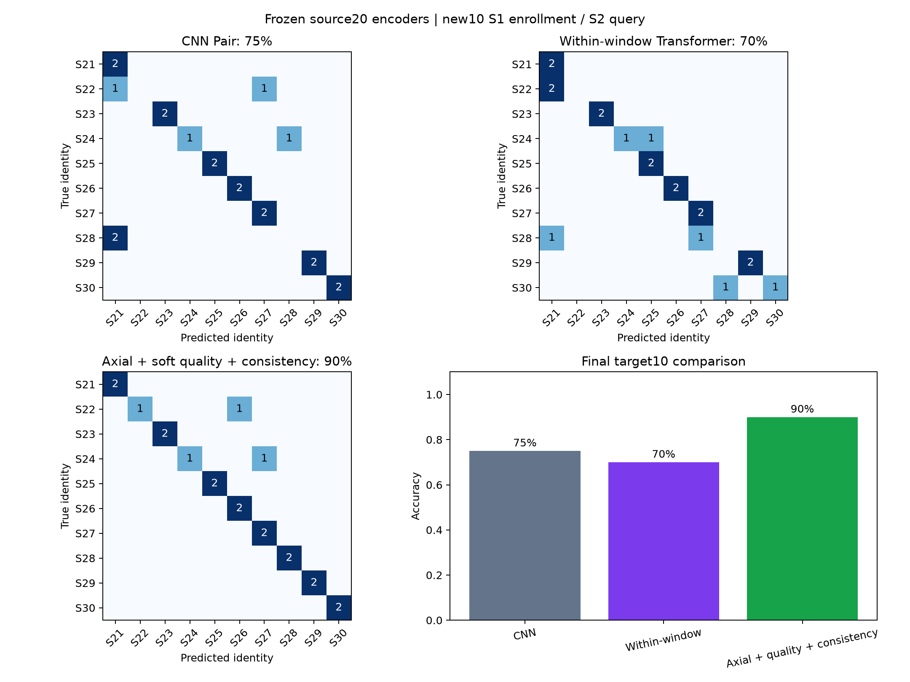
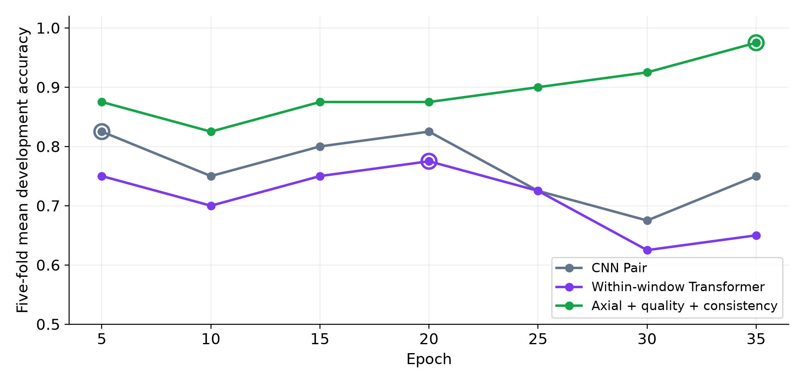
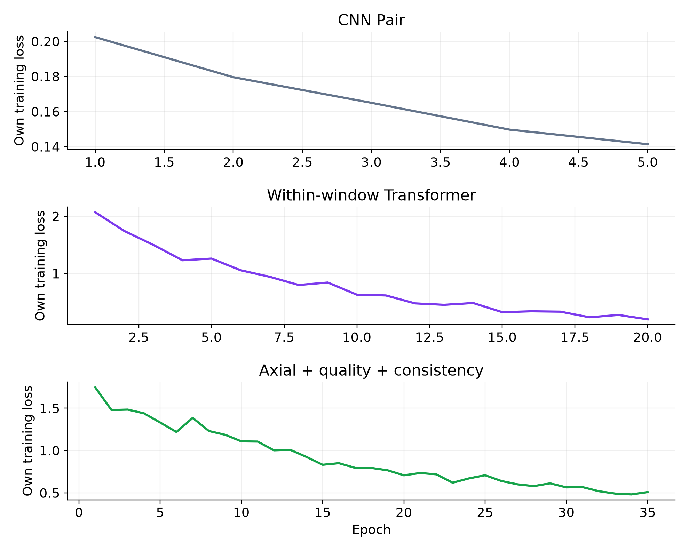

# 当前实验结果与解释范围

源S01–S20共20人两日期训练，模型冻结后，新S21–S30只用S1注册模板、S2做10选1闭集查询。每人离线/在线两阶段，合计20条查询；目标不参与训练、微调、早停或选择。

|完整方案|参数量|最终训练轮次|正确记录|准确率|离线 / 在线|
|---|---:|---:|---:|---:|---|
|纯CNN Pair 对照|13,232|5|15/20|75%|8/10 / 7/10|
|正弦窗内Transformer 对照|80,176|20|14/20|70%|8/10 / 6/10|
|本仓库完整轴向方案|87,680|35|18/20|90%|10/10 / 8/10|

这是当时TensorBoard图像插件导出的原图，对照模型仅作为历史结果展示，不包含在本仓库实现中。轴向相对CNN多正确3条、相对窗内多正确4条，在该批记录未引入新错。S28的两个阶段从对照模型误判改为正确；剩余错误为S22/S24在线阶段。

每折16人两日训练、4人S1注册/S2开发，每折8查询；曲线取五折公共轮次均值。共同轮次最好选择为CNN 5轮、窗内20轮、轴向35轮，同分取更早轮次。N=4开发分数不能直接与N=10最终分数比较；各折分别挑最高检查点的汇总也不同于统一轮次。

三个损失的组成和尺度不同，分开作图，不以绝对loss高低判断算法优劣。CNN、窗内、轴向的预处理、损失、训练预算不同，因此这是完整方案比较，不能独立归因于结构、质量或一致性模块。训练平台为RTX5070 Laptop GPU。

当前只有一个数据集、一个随机种子、10人20条相关阶段查询。单条记录占5个百分点；未证明统计显著性或跨数据集优势。下一步应预先固定外部验证协议，分别报告权重迁移和方法重新训练，并在统一预算和多种子下进行控制对照。若依据这10人错误调参，应另留测试身份。

该页面与图片为2026年10月16日整理的历史实验摘要，不是运行仓库就必定达到的性能承诺。完整本地汇报、逐记录原始元数据和模型文件未纳入上传包。
